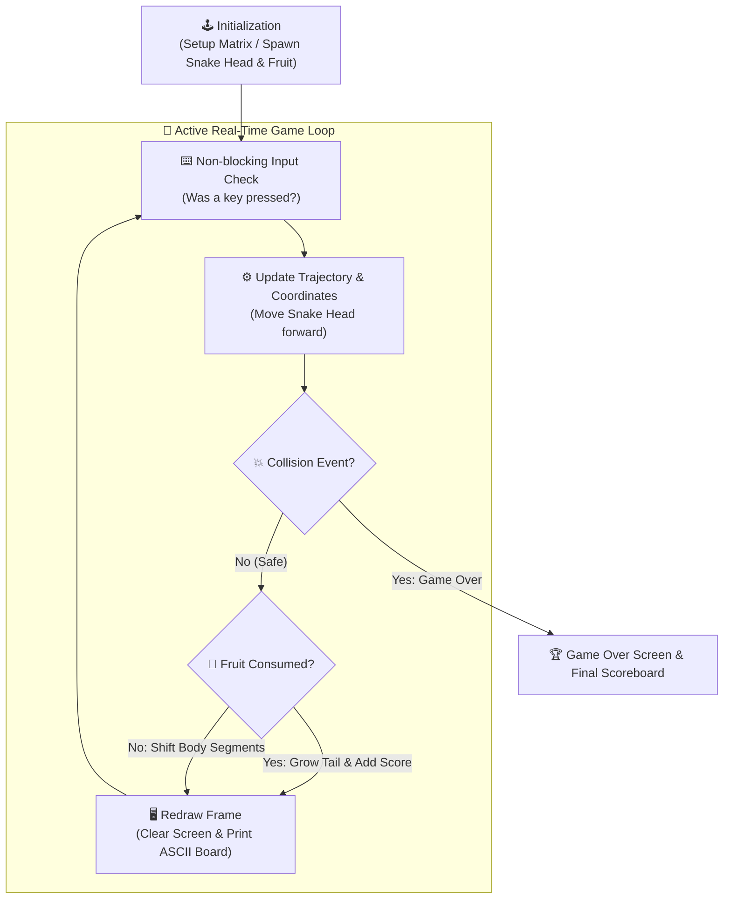

<div align="center">

# 🎮 Games Project — Classic Retro Arcade & Strategy Suite in C++

[](https://isocpp.org/)
[](#)
[](#)
[](#)

<p align="center">
  <b>A showcase of interactive retro games implemented in modern C++ highlighting non-blocking game loops, 2D coordinate collision detection, and deterministic matrix evaluation.</b>
</p>

[📌 About the Project](#-about-the-project) • [🛠️ Tech Stack](#️-comprehensive-tech-stack) • [🎮 Included Games](#-included-games) • [🔄 Game Loop Architecture](#-game-loop-architecture) • [🚀 How to Run](#-complete-how-to-run--compilation-guide)

---

</div>

## 📌 About the Project

**Games Project** explores real-time systems programming without the overhead of heavy third-party gaming engines. By directly programming game loops, non-blocking asynchronous user inputs, coordinate memory buffers, and win-state evaluations in C++, this repository demonstrates core computational principles of interactive applications.

---

## 🛠️ Comprehensive Tech Stack

| Domain | Technology | Specification / Standard |
| :--- | :--- | :--- |
| **Language** | **C++** | `C++17` Standard |
| **Supported Compilers** | **GCC (`g++`), Clang, MSVC** | Compatible across Windows, Linux, and macOS |
| **Input Handling** | **Non-blocking I/O** | `_kbhit()` & `_getch()` on Windows / POSIX `termios` on Linux |
| **Rendering Canvas** | **Console Terminal (CLI)** | ANSI Escape Sequences and Windows Console API |
| **Data Structures** | **Standard Template Library (STL)** | `std::vector`, `std::pair`, 2D multi-dimensional arrays |

---

## 🎮 Included Games

### 1. 🐍 Snake Classic
- **Coordinate Grid Engine**: Maintains a dynamic deque of $(X, Y)$ coordinate segments representing the snake body.
- **Collision Detection**: Real-time evaluation of wall perimeter impacts and self-intersecting tail collisions.
- **Dynamic Speed Progression**: Speed increases dynamically as the snake consumes fruit, raising the gameplay challenge.

### 2. ❌⭕ Tic Tac Toe (2 Players)
- **Deterministic $3 \times 3$ Matrix Evaluator**: Instant check of horizontal, vertical, and both diagonal winning axes.
- **Turn Alternation State Machine**: Seamless Player 1 (`X`) vs Player 2 (`O`) turns with overwrite prevention.

---

## 🔄 Game Loop Architecture



---

## 🚀 Complete How-To-Run & Compilation Guide

### 1. Prerequisites
Ensure you have a C++ compiler installed:
- **Windows**: MinGW-w64 (`g++ --version`) or Visual Studio C++ Compiler
- **Linux**: `sudo apt install build-essential`
- **macOS**: `xcode-select --install`

---

### 2. Running Snake Game

```bash
# 1. Clone repository:
git clone https://github.com/MominRifat/Games_Project.git
cd Games_Project/Snake_Game

# 2. Compile:
g++ -std=c++17 -O2 main.cpp -o snake

# 3. Play!
# On Windows:
.\snake.exe
# On Linux / macOS:
./snake
```

**Controls**:
- `W` / `↑` : Move Up
- `S` / `↓` : Move Down
- `A` / `←` : Move Left
- `D` / `→` : Move Right
- `X` : Exit Game

---

### 3. Running Tic Tac Toe

```bash
cd Games_Project

# Extract the Tic Tac Toe archive:
# On Windows PowerShell:
Expand-Archive -Path "Tic Tac Toe (2 Players).zip" -DestinationPath "TicTacToe"
cd TicTacToe

# Compile:
g++ -std=c++17 -O2 TicTacToe.cpp -o tictactoe

# Play:
.\tictactoe.exe
```

---

## 👨‍💻 Author

**Momin Rifat**  
- GitHub: [@MominRifat](https://github.com/MominRifat)  
- Location: Dhaka, Bangladesh
