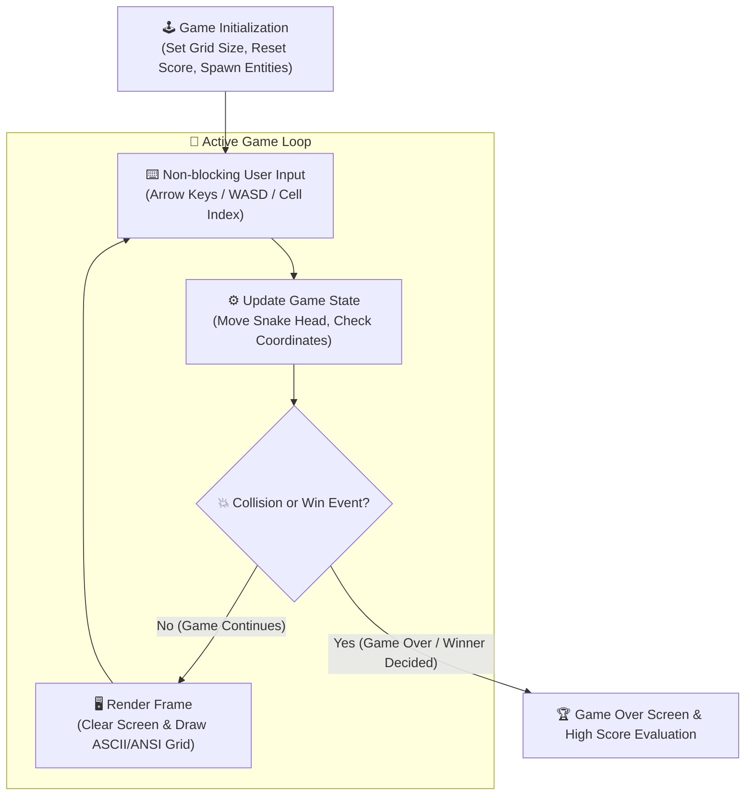

<div align="center">

# 🎮 Games Project — Classic Arcade & Strategy Suite in C++

[](https://isocpp.org/)
[](#)
[](#)
[](#)

<p align="center">
  <b>A showcase of interactive retro games developed in modern C++ focusing on algorithmic game loops, coordinate systems, collision detection, and multi-player state management.</b>
</p>

---

</div>

## 📌 Overview

**Games Project** contains lightweight, performant implementations of timeless classic games. Built directly from fundamental computer science principles, each game features robust game loop architectures without requiring bulky external game engine dependencies.

---

## 🕹️ Included Games

### 1. 🐍 Snake Classic
A complete recreation of the iconic retro Snake game featuring responsive coordinate grid manipulation and dynamic speed progression.

- **Coordinate Grid Engine**: 2D array representation $(X, Y)$ mapping the boundary walls, snake body segments, and spawned fruits.
- **Collision Detection**: Real-time evaluation of boundary impacts and self-intersecting body collisions.
- **Dynamic Score Scaling**: Incremental difficulty scaling where tail growth triggers higher snake velocity.

### 2. ❌⭕ Tic Tac Toe (2 Players)
An interactive two-player strategy game with an intuitive visual terminal board and deterministic win-condition evaluation.

- **$3 \times 3$ Matrix Evaluation**: Instant horizontal, vertical, and diagonal win detection.
- **Turn-based State Controller**: Alternating player inputs with robust input validation to prevent cell overwrites.
- **Draw Condition Detection**: Efficient full-grid state validation when no winning line is achieved.

---

## 🔄 Core Game Loop Architecture



---

## 📂 Repository Layout

```plaintext
Games_Project/
├── 📁 Snake_Game/
│   ├── 📄 main.cpp                     # Snake game source code
│   └── 📄 Makefile / build instructions
├── 📦 Tic Tac Toe (2 Players).zip      # Complete packaged 2-Player Tic Tac Toe project
└── 📄 README.md                        # Documentation & setup guide
```

---

## ⚡ Compilation & Execution

Compile directly using any modern standard C++ compiler (`g++`, `clang++`, or MSVC):

### 🐍 Running Snake Game
```bash
cd Snake_Game
g++ -std=c++17 -O2 main.cpp -o snake
# On Windows:
.\snake.exe
# On Linux/macOS:
./snake
```

### ❌⭕ Running Tic Tac Toe
Extract `Tic Tac Toe (2 Players).zip` and compile the source file:
```bash
g++ -std=c++17 -O2 "TicTacToe.cpp" -o tictactoe
.\tictactoe.exe
```

---

## 👨‍💻 Author

**Momin Rifat**  
- GitHub: [@MominRifat](https://github.com/MominRifat)  
- Location: Dhaka, Bangladesh
